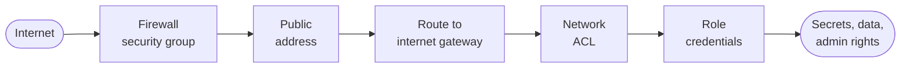
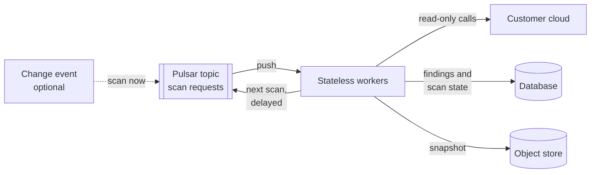

# Cloud Exposure Scanner

A small proof of concept of one cloud security check on AWS, where networking and identity meet. It finds machines that are reachable from the internet and carry a role that can read secrets or data, or take over the account.

A scanner that checks one setting at a time reports every open port and every broad role. This check joins them. It reports a finding only when the whole path is open, shows the evidence for every step, and says how to fix it.

It runs on JSON fixtures shaped like the real AWS API responses. It needs no cloud account.

This README follows the five questions of the case, in order, after the run instructions.

## Run it

Needs Go 1.22 or newer. Tested with Go 1.22.0 and 1.25.4. Standard library only.

```bash
go run ./cmd/scanner
```

This scans the demo environment and prints two findings and three similar cases that are not. Tests run with `go test ./...`.

## 1. Three checks I would build

| # | Check | Customer risk |
|---|---|---|
| 1 | **Stolen keys path.** A machine reachable from the internet whose role can read secrets or data, or take over the account. | One bug in a public service hands the attacker working cloud credentials. No password to phish, no account to break into. |
| 2 | **Really public bucket.** A bucket whose policy or ACL looks public, tested against Block Public Access and policy conditions. | Customer data readable by anyone. |
| 3 | **Outsider can become admin.** A role that another account, or a broad CI identity, can assume, and that leads to admin rights. | A forgotten vendor or pipeline trust becomes full control. |

I implemented check 1 and would build them in this order. Check 1 comes first because public addresses are probed all day, and it needs networking and identity together, which is where single checks are weakest. Check 2 is very common but noisy. Check 3 is less likely, because the attacker first needs a foothold in the trusted account.

## 2. Approach

**Data sources and APIs.** In a real integration the data comes from five read-only AWS calls. Each fixture file is named after the call it stands for and has the shape of the real response.

| Step | API call | Fixture file |
|---|---|---|
| Machines, public address, metadata service setting | `ec2:DescribeInstances` | `ec2-describe-instances.json` |
| Firewall | `ec2:DescribeSecurityGroups` | `ec2-describe-security-groups.json` |
| Route | `ec2:DescribeRouteTables` | `ec2-describe-route-tables.json` |
| Network ACL | `ec2:DescribeNetworkAcls` | `ec2-describe-network-acls.json` |
| Role, inline and attached policies, permissions boundary | `iam:GetAccountAuthorizationDetails` | `iam-get-account-authorization-details.json` |

**Permissions.** A cross-account role the customer creates, assumed with an ExternalId. The five actions above are all it needs. The AWS managed `SecurityAudit` policy is the usual simple option. Nothing in the design writes to the customer account.

**Existing tools.** The proof of concept uses none. It is Go standard library only.

In a real integration I would use:

- `aws-sdk-go-v2` to make the five read-only calls above.
- An open-source scanner such as Prowler as a baseline, to compare how many alerts each approach raises on the same account.

## 3. The check

### How it works

For each running machine the scanner checks five steps in order.



There are three possible answers:

- **Finding**: all five steps are open.
- **No finding**: at least one step is blocked. The output names the step.
- **Cannot tell**: a step could not be read, for example because a permission is missing, and no other step is blocked. It is never reported as a finding. A machine that is blocked at a step the scanner could read stays "no finding".

Severity is critical when the role gives admin rights or can raise itself to admin, or when the old metadata service (IMDSv1) is allowed, which makes the credentials easy to steal. Otherwise it is high.

### Examples

The demo environment has five machines. All five have a port open to the whole internet, so a single-setting check would flag all five. The scanner reports two findings.

```text
  CLOUD EXPOSURE SCAN  demo

  MACHINE        FIREWALL    ADDRESS     ROUTE       ACL         ROLE        VERDICT
  payments-api   ✕ open      ✕ open      ✕ open      ✕ open      ✕ open      FINDING · CRITICAL
  bastion        ✕ open      ✕ open      ✕ open      ✕ open      ✕ open      FINDING · HIGH
  batch-worker   ✕ open      ✓ blocked   ✓ blocked   ✕ open      ✕ open      NO FINDING
  docs-site      ✕ open      ✕ open      ✕ open      ✕ open      ✓ blocked   NO FINDING
  legacy-admin   ✕ open      ✕ open      ✕ open      ✓ blocked   ✕ open      NO FINDING

  2 findings   3 no finding   0 cannot tell
```

#### A case that produces a finding

```text
   FINDING · HIGH   bastion  i-0a1b2c3d4e5f60002

  WHY      Reachable from the internet on tcp/22. Its role ops-bastion-role can read secrets.
  PATH     internet → sg-0bb2222222222222b tcp/22 → bastion → ops-bastion-role → secrets
  NEEDS    A weak login or an exploit on tcp/22. No AWS credentials.

  STEP            EVIDENCE
  firewall        sg-0bb2222222222222b allows tcp/22 from 0.0.0.0/0
  public address  public address 203.0.113.20
  route           rtb-0f1111111111111aa sends 0.0.0.0/0 to igw-0d44444444444444d
  network ACL     acl-0a1111111111111aa rule 100 allows tcp/22 in, rule 100 allows replies out
  role            ops-bastion-role allows ssm:GetParameter* on * (policy ops-read-config)
  read from       ec2-describe-security-groups.json:17, ec2-describe-instances.json:36,
                  ec2-describe-route-tables.json:4, ec2-describe-network-acls.json:4,
                  iam-get-account-authorization-details.json:32

  OTHER CONTROL         STATUS      NOTE
  IMDSv2 enforced       ✓ in place  HttpTokens is required, so a request forgery bug alone
                                    cannot read the credentials
  Permissions boundary  ✕ missing   None on ops-bastion-role, so nothing caps what the role can
                                    do

  REMEDIATION
  1. Close tcp/22 to the internet on sg-0bb2222222222222b. Use SSM Session Manager, or allow one
     known address range.
  2. Scope ssm:GetParameter* in policy ops-read-config to the resources this machine needs, not
     *.
```

#### An apparently similar case that does not

`batch-worker` uses the same security group as `bastion`, and its role can also read secrets. It is not reachable, so it is not a finding. The output names the step that blocks each machine, and the finding it looks like.

```text
  NO FINDING, AND WHY

  batch-worker   Blocked at public address: the machine has no public address
                 (ec2-describe-instances.json:65). Blocked at route: rtb-0f2222222222222bb sends
                 0.0.0.0/0 to nat-0e55555555555555e, which accepts no inbound connections
                 (ec2-describe-route-tables.json:16). Same open firewall rule as bastion.
  docs-site      Blocked at role: docs-site-role grants nothing sensitive
                 (iam-get-account-authorization-details.json:43). Same open firewall rule as
                 payments-api.
  legacy-admin   Blocked at network ACL: acl-0a2222222222222bb rule 90 denies tcp/22 from
                 0.0.0.0/0 (ec2-describe-network-acls.json:19). Same open firewall rule as
                 bastion.
```

## 4. Limits of the conclusion

**Controls that could change the result**

| Group | Controls | Effect on the result |
|---|---|---|
| Other entry points | Load balancer or API gateway, IPv6, VPC peering, transit gateway, VPN | A missed finding: the machine is reachable another way |
| Additional network filtering | Host firewall, WAF, AWS Network Firewall | A false alarm: the path I call open is blocked |
| Identity guardrails | Deny statements, policy conditions, permissions boundary, service control policies, session policies, resource policies on the bucket or secret | A false alarm: the role can do less than its policy says |

- **Handled today:** IMDSv2, as severity. Network ACL rules for `0.0.0.0/0`, with first match wins. A permissions boundary is reported as present, not evaluated.
- **Partly handled:** a security group port range is tested against the network ACL on its first port only, and network ACL rules for narrower address ranges are not read.
- **Which gap comes first:** load balancers, because a missed finding is worse than a false alarm. Entry points in another account would be covered by the join across accounts in section 5.

A finding here means "the configuration allows it". It does not mean "a vulnerable service is listening". That needs runtime or scan data, which I would use to raise or lower severity.

**When data or permissions are missing**

- The answer is "cannot tell". It is never "pass" and never "fail".
- The report names the API call and the error code, and tells the customer which permission to check.
- When the role could be read, it says what the worst case would be, so the customer can judge the urgency.
- Empty is not the same as zero. A route table the scanner could not read is not "no route".
- If `ec2:DescribeInstances` itself fails, the scan stops with an error. There is nothing honest to report.

**Example.** Run `go run ./cmd/scanner --fixtures fixtures/missing-permission`. In that environment the scanner is denied `ec2:DescribeRouteTables`. The machines whose answer depends on the route become "cannot tell". The machines that are already blocked at another step stay "no finding".

```text
  CLOUD EXPOSURE SCAN  missing-permission

  MACHINE        FIREWALL    ADDRESS     ROUTE       ACL         ROLE        VERDICT
  payments-api   ✕ open      ✕ open      ? unknown   ✕ open      ✕ open      CANNOT TELL
  bastion        ✕ open      ✕ open      ? unknown   ✕ open      ✕ open      CANNOT TELL
  batch-worker   ✕ open      ✓ blocked   ? unknown   ✕ open      ✕ open      NO FINDING
  docs-site      ✕ open      ✕ open      ? unknown   ✕ open      ✓ blocked   NO FINDING
  legacy-admin   ✕ open      ✕ open      ? unknown   ✓ blocked   ✕ open      NO FINDING

  0 findings   3 no finding   2 cannot tell
  The scanner could not read: ec2:DescribeRouteTables
```

## 5. Production scale: 3,000 environments

This section is a design. None of it is built in this proof of concept.

### What the design must guarantee

- **Every account is scanned on time,** and a change is picked up within minutes.
- **The scanner never hurts the customer.** It is read-only and stays well inside AWS rate limits.
- **One slow, large or broken account does not delay the others.**
- **The same design fits one customer with 3,000 accounts and 3,000 customers with one account each.**
- **Findings stay quiet and true.** One problem is one item, and missing data never reads as "safe".

### Architecture



- **Pulsar topic.** One message means "scan this account". It is the queue and the schedule.
- **Stateless workers.** Each one takes a message, scans one account and saves the result. More load means more workers.
- **Database.** Findings and the state of each account: last scan, lease, coverage, failures.
- **Object store.** The raw answers of each scan, kept for a short time as evidence.

<details>
<summary><b>More detail: how one scan runs, AWS rate limits, linked accounts, capacity</b></summary>

### How one scan runs

1. A worker receives a scan request.
2. It takes a lease on the account in the database.
3. It reads the account with a short-lived read-only session.
4. It runs the checks and compares the results with the open findings.
5. It saves everything in one transaction, which only goes through if it still holds the lease.
6. It publishes the next request for this account with a delay, then acknowledges the message.

### Key decisions

- **The schedule lives in the queue.** The next scan is a delayed message, so there is no separate scheduler. A sweeper republishes any account that has gone too long without a scan.
- **A lease in the database guarantees one scan per account,** and stops a slow worker from overwriting newer results.
- **A change event is only a request to scan.** Requests inside a minimum gap are dropped, so a burst of events becomes one scan.
- **Workers scale on the messages that are due now.** A scan that keeps failing ends in the dead-letter topic, where an operator sees it.

### AWS rate limits

- **Limits are per account,** and shared with the customer's own tools. Using the whole allowance would break their deploys.
- **One scan per account at a time,** guaranteed by the lease.
- **A rate cap inside the scan,** per account and region, set well below the AWS limit.
- **Throttled is not empty.** A throttled call is retried with backoff. If it still fails, that region is "cannot tell".
- **3,000 accounts are not one large limit problem.** Each account is paced on its own.

### Across accounts

- **Accounts of one customer can be linked** by shared networking and by roles that trust each other. Each scan saves a short list of what points outside the account. When that list changes, the worker publishes a join request for the customer, and a worker that picks it up joins the lists of all that customer's accounts.
- **A finding keeps one identity across scans,** and the same problem in many accounts is one item with one fix.
- **"Cannot tell" never closes a finding.**

### Capacity

> workers = accounts x minutes per scan / minutes between scans

As an example: 3,000 accounts, 3 minutes per scan, every 6 hours needs about 25 scans at once. Connecting all 3,000 at once would take those 25 workers 6 hours, so workers are added while messages are waiting. The 3 minutes is an assumption, and the first thing to measure.

</details>

### Before production, in this order

1. **Measure a real scan:** time, API calls, throttling and memory, on small and large accounts.
2. **Real-shaped test cases** for every verdict. Noise is a correctness bug.
3. **A coverage report per account,** so the customer sees what the scanner could not read.
4. **Finding identity and grouping,** so one problem is one item.
5. **Isolation between customers:** a read-only role per account, no stored credentials, snapshots encrypted per customer and deleted after a short retention.
6. **Check changes tried on stored snapshots first,** before they can open findings.

## Assumptions

- AWS, EC2 instances, IPv4, TCP.
- "The internet" means a rule for `0.0.0.0/0`.
- Fixtures use made-up resource IDs, the AWS example account ID and documentation address ranges.

## Limitations

- One account, one region, one resource type. There is no live collection.
- The controls in section 4 are not evaluated, so a result can be a missed finding or a false alarm.
- The role step reads a short, hand-written list of sensitive actions, and does not read `NotAction` or `NotResource`.
- A known source of noise: the AWS managed policy `AmazonSSMManagedInstanceCore` allows `ssm:GetParameter` on every resource, so a machine managed by Systems Manager counts as able to read secrets.

## What I would do next

1. A read-only live collector that writes the same five files, run on real accounts to measure time and API calls per scan.
2. Load balancers and API gateways as entry points, so private machines behind a public endpoint are covered.
3. Evaluate Deny statements, conditions and permissions boundaries.
4. The same path for Lambda, ECS tasks and EKS nodes, then checks 2 and 3 from section 1.
